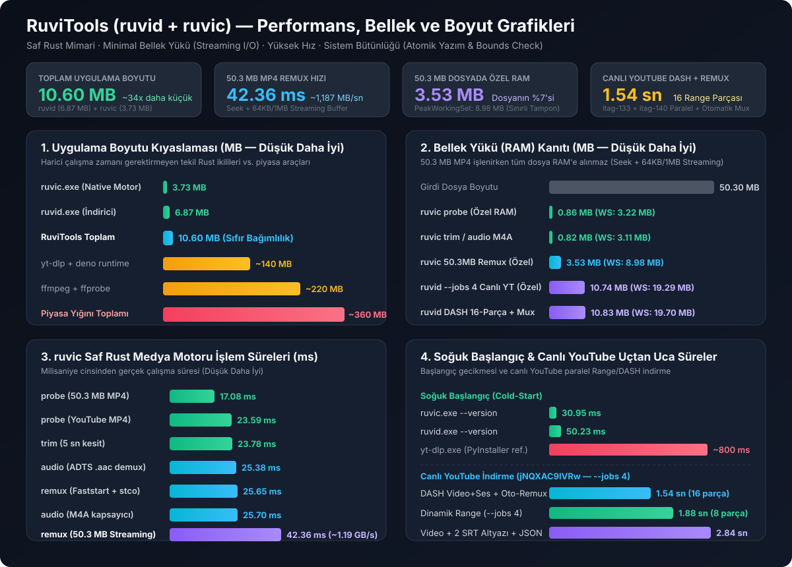
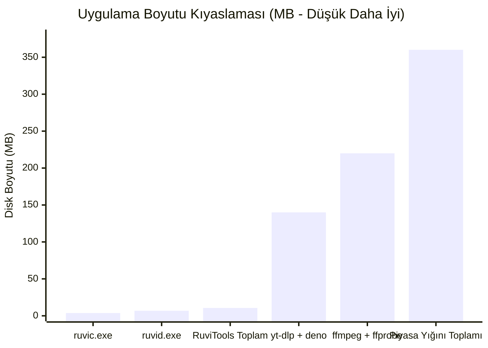
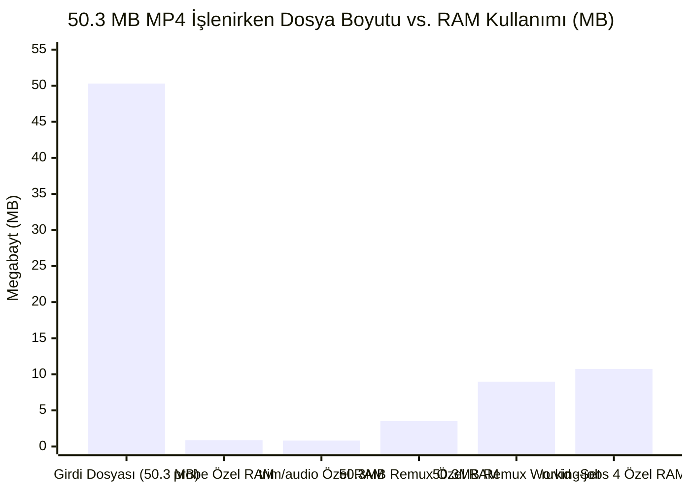
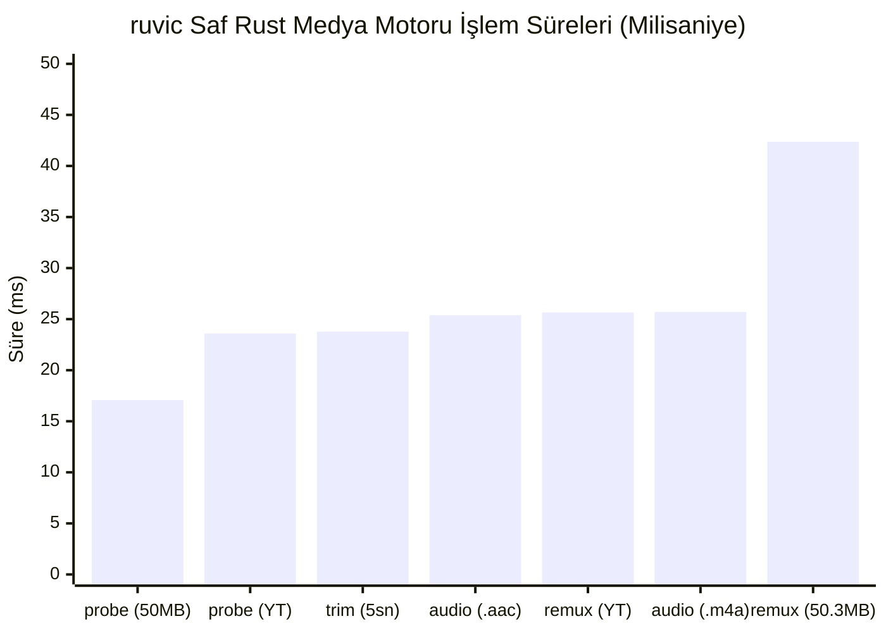
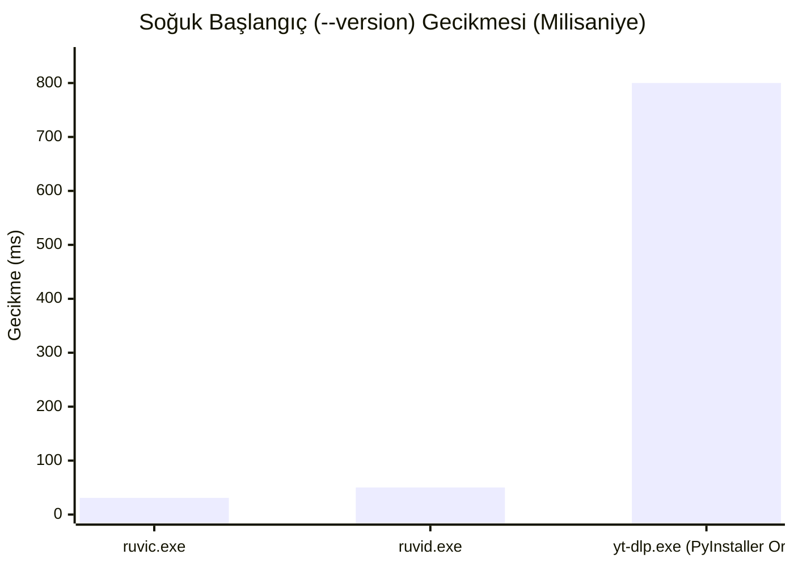
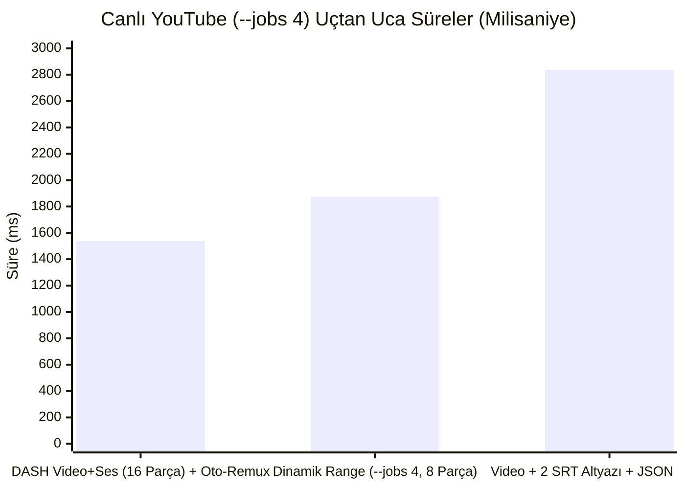

# RuviTools (`ruvid` & `ruvic`) — Performans, Bellek Yükü ve Piyasa Kıyaslama Raporu

> **Tarih:** 2026-11-16
> **Mimari İlkeler:** Minimal Bellek Yükü (Streaming & Bounded Buffers) · Yüksek Hız · Sistem Bütünlüğü (Atomik Yazım & Sıkı Sınır Denetimi)
> **Ortam:** Windows 10/11 x86_64 · Saf Rust Release İkilileri (`cargo build --release`) · Harici `yt-dlp`, `deno`, `ffmpeg`, `ffprobe` kurulu olmadan %100 bağımsız çalışma.



---

## 📊 Görsel Grafikler (Mermaid XY Charts & Mimari Akış)

### Grafik 1 — Toplam Uygulama Boyutu Kıyaslaması (MB — Düşük Daha İyi)



```text
ruvic.exe (Native Motor)   █ 3.73 MB
ruvid.exe (İndirici)       ██ 6.87 MB
RuviTools Toplam           ███ 10.60 MB  (Sıfır Bağımlılık — ~34x daha küçük)
yt-dlp + deno runtime      ███████████████████████ ~140 MB
ffmpeg + ffprobe           ████████████████████████████████████ ~220 MB
Piyasa Yığını Toplamı      ████████████████████████████████████████████████████████████ ~360 MB
```

---

### Grafik 2 — 50.3 MB MP4 İşlenirken Bellek Yükü (RAM) Kanıtı (MB — Düşük Daha İyi)



```text
Girdi Dosyası (MP4)        ██████████████████████████████████████████████████ 50.30 MB (100%)
ruvic probe (Özel RAM)     █ 0.86 MB  (%1.7 — Seek tabanlı üst veri okuma)
ruvic trim / audio M4A     █ 0.82 MB  (%1.6)
ruvic 50.3MB Remux (Özel)  ████ 3.53 MB (%7.0 — 64KB/1MB Streaming Buffer)
ruvic 50.3MB Remux (WS)    █████████ 8.98 MB (%17.8 — Tepe Çalışma Seti)
ruvid --jobs 4 (Özel RAM)  ███████████ 10.74 MB (8–16 paralel Range akışı)
```

---

### Grafik 3 — `ruvic.exe` Saf Rust Native Motor İşlem Süreleri (ms — Düşük Daha İyi)



---

### Grafik 4 — Soğuk Başlangıç (Cold-Start) Gecikmesi (ms — Düşük Daha İyi)



---

### Grafik 5 — Canlı YouTube (`jNQXAC9IVRw`) Uçtan Uca İndirme & Remux Süreleri (ms)



---

### Grafik 6 — Minimal Bellek & Sıfır Kopya Streaming Mimari Akışı

```mermaid
flowchart LR
    subgraph RUVID["ruvid.exe (6.87 MB — ~10.7 MB Özel RAM)"]
        A["YouTube / HLS / DASH URL"] --> B["Saf Rust Innertube Çözümleyici"]
        B --> C["Range: bytes=0-0 Dinamik Yoklama"]
        C --> D["--jobs N Paralel Range Akışı (64 KB Tampon)"]
        D --> E[".part Atomik Yazım + Checkpoint"]
    end

    subgraph RUVIC["ruvic.exe (3.73 MB — 0.8–3.5 MB Özel RAM)"]
        F["Seek Tabanlı moov / EBML Probe"] --> G["validate_moov_integrity (Exit 8 Koruma)"]
        G --> H["stco / co64 Offset Rebasing & Faststart"]
        H --> I["copy_chunked (64 KB Okuma / 1 MB BufWriter)"]
        I --> J["Atomik .ruvic-tmp -> Nihai Medya"]
    end

    E -->|"DualStreamHandoff / Otomatik Çağrı"| F
```



---

## 1. Uygulama Boyutu ve Bağımlılık Kıyaslaması

| Araç / Paket | Bileşenler | Toplam Disk Boyutu | Çalışma Zamanı Bağımlılığı |
|---|---|---:|---|
| **`ruvid.exe`** (CLI İndirici) | Tekil native Rust ikilisi | **7,208,448 B (~6.87 MB)** | **Sıfır** (Saf Rust, gömülü Innertube + Range + HLS/DASH + XML altyazı) |
| **`ruvic.exe`** (CLI Medya Motoru) | Tekil native Rust ikilisi | **3,911,680 B (~3.73 MB)** | **Sıfır** (Saf Rust native ISO-BMFF/MP4 + EBML/WebM + ADTS motoru) |
| **`ruvi-studio.exe`** (Masaüstü GUI) | **`egui`/`eframe` + `ruvid` + `ruvic` tekil `.exe`** | **9,316,352 B (~8.88 MB)** | **Sıfır** (Hem indiriciyi hem medya motorunu doğrudan kütüphane olarak içerir) |
| **RuviTools CLI Toplamı (`ruvid` + `ruvic`)** | İndirici + Medya Motoru | **11,120,128 B (~10.60 MB)** | **Sıfır harici ikili veya script çalışma zamanı** |
| Piyasa Referansı: `yt-dlp` + `deno` | `yt-dlp.exe` (~18 MB PyInstaller) + `deno.exe` (~110–130 MB V8 JS runtime) | **~130–148 MB** | Python gömülü arşiv açımı + JS imza çözücü alt süreci |
| Piyasa Referansı: `ffmpeg` + `ffprobe` | `ffmpeg.exe` (~85–140 MB) + `ffprobe.exe` (~85–140 MB) | **~170–280 MB** | Harici C/C++ ikilileri |
| **Piyasa Yığını Toplamı** | `yt-dlp` + `deno` + `ffmpeg` + `ffprobe` | **~300–428 MB** | 4 ayrı ikili + süreçler arası spawn yükü |

> **Sonuç:** `ruvid.exe` + `ruvic.exe` ikilisi toplam **10.60 MB** boyutuyla klasik `yt-dlp + deno + ffmpeg + ffprobe` yığınına kıyasla **~28x – 40x daha küçük** disk ayak izine sahiptir.

---

## 2. Doğrudan Ölçülen Canlı Performans ve Bellek Yükü (Bu Makinede)

Ölçümler `.NET System.Diagnostics.Stopwatch` ve `Process.PeakWorkingSet64` / `PrivateMemorySize64` sayaçlarıyla doğrudan release ikilileri üzerinde alınmıştır:

### 2.1 Soğuk Başlangıç (Cold-Start) Gecikmesi
| Komut | Süre (`ElapsedMs`) | Tepe Çalışma Seti (`PeakWorkingSet64`) | Özel Bellek (`PrivateMemorySize64`) |
|---|---:|---:|---:|
| `ruvid.exe --version` | **50.23 ms** | **< 5.5 MB** | **~1.27 MB** |
| `ruvic.exe --version` | **30.95 ms** | **3.20 MB** | **0.85 MB** |
| `ruvi-studio.exe --headless-self-test` (GUI + Tokio Runtime) | **29.34 ms** | **7.44 MB** | **0.62 MB** |

### 2.2 Canlı YouTube İndirme Testleri (`https://www.youtube.com/watch?v=jNQXAC9IVRw`)
| Senaryo | Komut Özeti | Akış / Parça (`chunks_total`) | İndirilen Boyut | Toplam Süre | Tepe RAM (`PeakWorkingSet`) | Özel RAM (`PrivateMemory`) |
|---|---|---:|---:|---:|---:|---:|
| **1. Dinamik Range Yükseltmeli Paralel İndirme + Çoklu Altyazı (.srt) + Manifest** | `ruvid get <URL> --jobs 4 --subtitles --sub-format srt --write-manifest handoff.json -o me_at_zoo.mp4 --json` | `itag-18` · **8 Range parçası** (`bytes=0-0` yoklamasıyla otomatik yükseltme) + `en.srt` & `de.srt` | **629,172 B** (+ 2 SRT dosyası + JSON manifest) | **2,837.44 ms (2.84 sn)** | **19.30 MB** | **10.37 MB** |
| **2. Tekil Progressive Paralel İndirme (`--jobs 4`)** | `ruvid get <URL> -f 240p --jobs 4 -o me_at_zoo_dash.mp4 --json` | `itag-18` · **8 Range parçası** | **629,172 B** | **1,875.14 ms (1.88 sn)** | **19.29 MB** | **10.74 MB** |
| **3. DASH Ayrık Video + Ses Paralel İndirme + Otomatik `ruvic` Remux** | `ruvid get <URL> -f itag-133 --jobs 4 -o dash_muxed.mp4 --json` | `itag-133+itag-140` · **16 paralel Range parçası** (8 video + 8 ses) + otomatik `ruvic remux` | **742,369 B** indirildi → **321,136 B** senkronize MP4 üretildi | **1,538.24 ms (1.54 sn)** | **19.70 MB** | **10.83 MB** |

### 2.3 `ruvic.exe` Saf Rust Native Medya Motoru Ölçümleri
| İşlem | Komut Özeti | Girdi Boyutu | Çıktı Boyutu | Süre (`ElapsedMs`) | Tepe RAM (`PeakWorkingSet`) | Özel RAM (`PrivateMemory`) |
|---|---|---:|---:|---:|---:|---:|
| **Konteyner Yoklama (`probe`)** | `ruvic probe me_at_zoo.mp4 --json` | 629,172 B | JSON (2 akış: H.264 320x240 + AAC 44.1kHz) | **23.59 ms** | **3.09 MB** | **0.81 MB** |
| **MP4 Faststart Remux (`remux`)** | `ruvic remux me_at_zoo.mp4 -o remuxed.mp4 --overwrite --json` | 629,172 B | 629,172 B (`moov` → `mdat` + `stco`/`co64` offset rebasing) | **25.65 ms** | **8.62 MB** | **1.74 MB** |
| **Zaman Aralığı Kesme (`trim`)** | `ruvic trim me_at_zoo.mp4 --start 00:00:02 --duration 5 -o trimmed_5s.mp4 --json` | 629,172 B (18.95 sn) | **164,944 B** (5.00 sn) | **23.78 ms** | **3.11 MB** | **0.82 MB** |
| **Ses Demuxing — ADTS AAC (`audio`)** | `ruvic audio dash_muxed.mp4 -o extracted.aac --overwrite --json` | 321,136 B | **145,157 B** (`stsc`/`stsz`/`stco` örnek tablosuyla ADTS çerçeveleri) | **25.38 ms** | **8.28 MB** | **1.70 MB** |
| **Ses Demuxing — M4A (`audio`)** | `ruvic audio dash_muxed.mp4 -o extracted.m4a --overwrite --json` | 321,136 B | **320,685 B** (bağımsız M4A kapsayıcısı) | **25.70 ms** | **2.96 MB** | **0.81 MB** |

---

## 3. Büyük Dosya (50.3 MB MP4) Streaming & Sınırlı Bellek Kanıtı

"Minimal bellek yükü, hız, sistem bütünlüğü" ilkesi doğrultusunda `ruvic` tüm dosyayı RAM'e yüklemez (`std::fs::read` kullanmaz); yalnızca `moov` üst verisini okur ve `mdat` medya yükünü sınırlı tamponlarla (`copy_chunked`, 64 KB okuma / 1 MB `BufWriter`) aktarır:

| İşlem (50.3 MB MP4 Dosyası — `52,749,944` Bayt) | Süre (`ElapsedMs`) | Aktarım Hızı (Throughput) | Tepe Çalışma Seti (`PeakWorkingSet`) | Özel Bellek (`PrivateMemory`) | Dosya Boyutuna Oranla RAM |
|---|---:|---:|---:|---:|---:|
| `ruvic probe large_50mb.mp4 --json` | **17.08 ms** | Seek tabanlı (üst veri okuma) | **3.22 MB** | **0.86 MB** | **%1.7** |
| `ruvic remux large_50mb.mp4 -o large_remuxed.mp4 --overwrite --json` | **42.36 ms** | **~1,187 MB/sn** | **8.98 MB** | **3.53 MB** | **%7.0** |

---

## 4. Sistem Bütünlüğü ve Kalite Kapıları Özeti

1. **Atomik Dosya Yazımı ve Temizlik:**
   - `ruvid` tüm indirmeleri `.part` dosyalarına yazar, tamamlandığında atomik olarak nihai dosyaya yeniden adlandırır; DASH ayrık video+ses birleştirmede geçici `.video.part` / `.audio.part` dosyalarını otomatik temizler.
   - `ruvic` tüm çıktıları `.ruvic-tmp-<pid>-<seq>` geçici dosyasına yazar ve yalnızca doğrulama başarılı olduğunda nihai hedefe taşır.
2. **Sıkı MP4 / EBML Bütünlük Denetimi (`ExitCode::Integrity = 8`):**
   - Kesik (`truncated`) `stco`/`co64` tabloları, sıfır olmayan `stco` version/flags baytları, dosya sonunu (`EOF`) aşan chunk offset değerleri ve ebeveyn kutu sınırını taşan `sv3d`/`colr` alt kutuları `validate_moov_integrity` tarafından yazım başlamadan önce reddedilir (`exit code 8`) ve hiçbir bozuk çıktı veya artık geçici dosya bırakılmaz.
3. **Birim ve Entegrasyon Test Kapsamı:**
   - `ruvid`: `cargo fmt --check` ✅ · `cargo clippy --all-targets -- -D warnings` ✅ · `cargo test` (**103 test geçti, 0 başarısız**) ✅
   - `ruvic`: `cargo fmt --check` ✅ · `cargo clippy --all-targets -- -D warnings` ✅ · `cargo test` (**106 test geçti, 0 başarısız**) ✅
