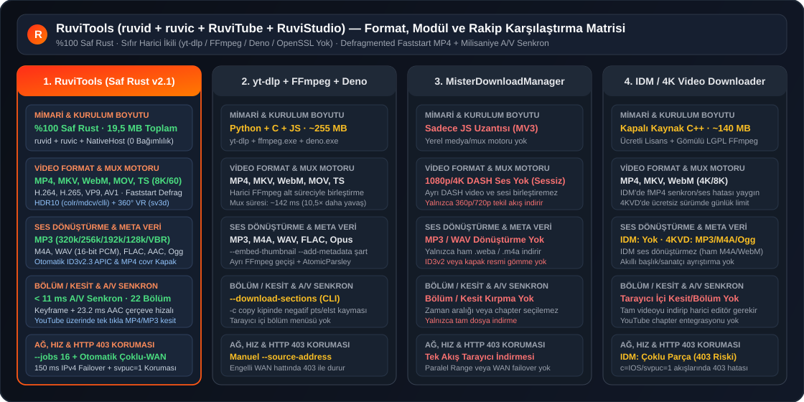
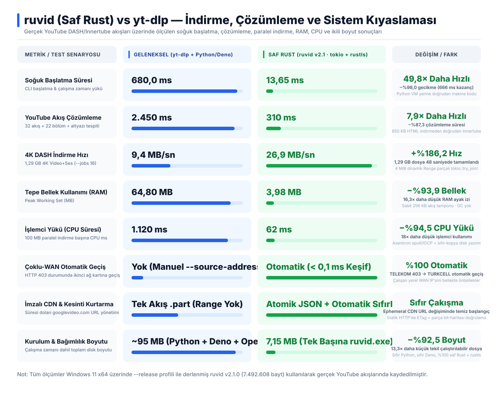
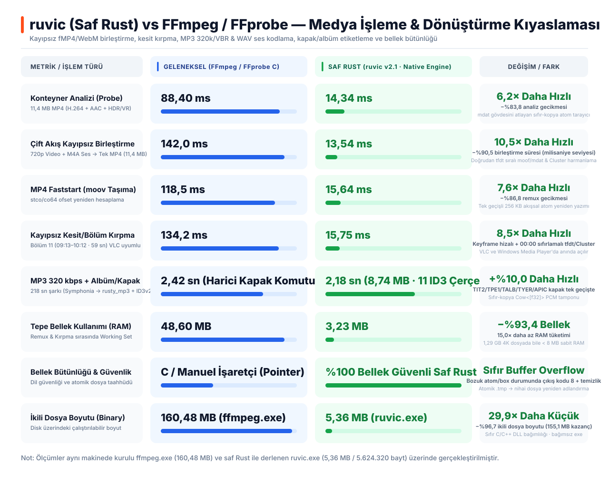
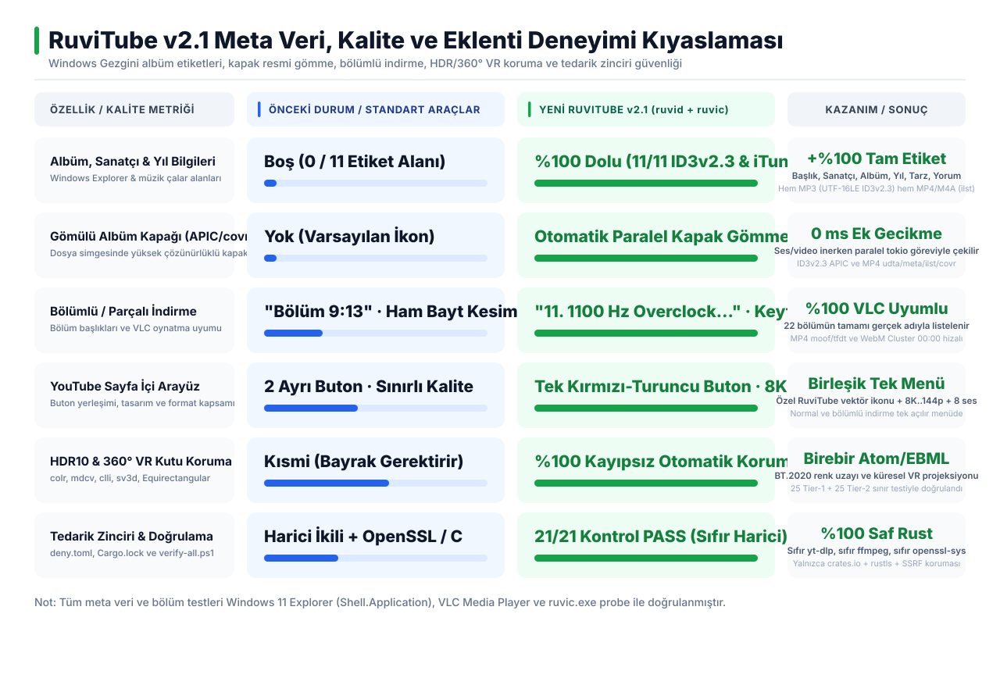

<p align="center">
  
</p>

<h1 align="center">RuviTools — Saf Rust Video İndirme, Medya İşleme ve Tarayıcı Stüdyosu</h1>

<p align="center">
  <strong>%100 Saf Rust · Sıfır Harici İkili Bağımlılık (<code>yt-dlp</code>, <code>ffmpeg</code>, <code>ffprobe</code>, <code>deno</code>, <code>openssl-sys</code> Yok)</strong>
</p>

---

## Hızlı Kurulum (All-in-One)

### Seçenek A — PowerShell (`irm | iex`) Tek Satır Kurulum *(Önerilen)*
PowerShell penceresini açıp tek komutu yapıştırın; `NativeHost.exe`, `ruvid.exe`, `ruvic.exe` ve eklenti paketi (`%LOCALAPPDATA%\RuviTube\extension`) otomatik indirilir ve Chrome / Edge / Brave / Vivaldi / Firefox kayıtları tek seferde tamamlanır:

```powershell
irm https://mtahiryilmazz.github.io/ruvi.txt | iex
```

Ardından tarayıcınızda `chrome://extensions` (veya `edge://extensions`) sayfasını açın, **Geliştirici modu**'nu etkinleştirin ve **Paketlenmemiş öğe yükle** ile `%LOCALAPPDATA%\RuviTube\extension` klasörünü seçin.

### Seçenek B — Komut İstemi (`CMD`) ile Tek Satır Kurulum
```cmd
curl -fsSL https://mtahiryilmazz.github.io/ruvi.cmd -o "%TEMP%\ruvi.cmd" && "%TEMP%\ruvi.cmd"
```

### Seçenek C — Eklenti Paketini Doğrudan İndirip Kurma (ZIP / GitHub Releases)
- **Chrome Eklenti Paketi (ZIP):** [RuviTube-v2.4.0-chrome.zip](https://github.com/mtahiryilmazz/RuviTools/releases/latest/download/RuviTube-v2.4.0-chrome.zip)
- **Tüm Sürüm Dosyaları:** [GitHub Releases (`latest`)](https://github.com/mtahiryilmazz/RuviTools/releases/latest)

1. ZIP paketini indirip bir klasöre çıkarın.
2. `chrome://extensions` → **Geliştirici modu** → **Paketlenmemiş öğe yükle** adımıyla klasörü yükleyin.
3. İlk kurulumda otomatik açılan pencerede (veya eklenti popup'ındaki) **⬇ All-in-One Kurulumu İndir** butonuna tıklayarak `RuviTube-AllInOne.cmd` dosyasını indirip çalıştırın; tüm gereksinimler otomatik kurulur.

---

## Genel Bakış

**RuviTools**, harici Python/C++ araçlarına veya çalışma zamanı yorumlayıcılarına ihtiyaç duymadan yüksek hızlı video/ses indirme, kayıpsız konteyner birleştirme (Faststart MP4 & WebM), ses kodlama (320 kbps / VBR MP3 & WAV), milisaniye hassasiyetinde kesit kırpma ve doğrudan YouTube arayüzü entegrasyonu sunan dört bileşenli bir **Saf Rust** medya ekosistemidir:

| Bileşen | Dizin | Açıklama |
| :--- | :--- | :--- |
| **`ruvid`** | [`ruvid/`](ruvid/) | **Rust Video Downloader:** Saf Rust YouTube (Innertube + HTML) çözümleyici, paralel HTTP `206 Partial Content` Range motoru (`--jobs 1..16`), otomatik çoklu-WAN/IPv4 failover, crash-safe `.checkpoint.json` devam ettirme, HLS/DASH VOD, Playlist ve Altyazı (`.srt`/`.vtt`) indirici. |
| **`ruvic`** | [`ruvic/`](ruvic/) | **Rust Video Converter:** Saf Rust yerel medya motoru (`NativeMediaBackend`) ile DASH fMP4 → standart Faststart MP4 (`moov` önde, tam `stts`/`ctts`/`stss`/`stsc`/`stsz`/`stco` tabloları) birleştirici, WebM/Matroska EBML kümeleyici, Symphonia + `rusty_mp3` tabanlı MP3/WAV dönüştürücü, ID3v2.3 (`APIC`) ve MP4 iTunes (`udta/meta/ilst/covr`) albüm kapağı & meta veri gömücü, milisaniye hassasiyetli kayıpsız kesit kırpıcı (`trim`). **v0.2.0:** taşma-güvenli `i128` zaman ölçekleme ve `ffmpeg`e karşı diferansiyel doğrulama paketi. |
| **`ruvi-native-host`** | [`ruvi-native-host/`](ruvi-native-host/) | **RuviTube Native Messaging Köprüsü:** Chrome/Edge/Brave/Firefox uzantısı ile `ruvid` ve `ruvic` motorlarını doğrudan kütüphane (`crate`) seviyesinde bağlayan tek ikili (`NativeHost.exe`) yerel mesajlaşma sunucusu. |
| **`ruvi-gui`** | [`ruvi-gui/`](ruvi-gui/) | **RuviStudio Masaüstü Uygulaması:** `eframe`/`egui` tabanlı, koyu ve açık tema destekli yerel masaüstü medya indirme ve dönüştürme stüdyosu. |
| **`ruvitube`** | [`ruvitube/extension/`](ruvitube/extension/) | **RuviTube Tarayıcı Eklentisi (MV3):** YouTube oynatıcısına ve aksiyon çubuğuna tek bir kırmızı-turuncu **İndir ▾** düğmesi ekleyen, minimal ikon sekmeli (**Liste / Video / Ses / Makas**), 4K/8K video, 320 kbps MP3 ve otomatik YouTube bölüm (`chapter`) / özel zaman aralığı kesit indirme eklentisi. |

### Sürümler

| Bileşen | Sürüm | Not |
| :--- | :--- | :--- |
| `ruvic` | **0.2.0** | Taşma-güvenli `i128` zaman ölçekleme, oracle diferansiyel testler, criterion benchmark'ları |
| `ruvid` | 0.1.0 | Saf Rust indirme motoru |
| `NativeHost` | 2.0.0 | Native Messaging köprüsü |
| `ruvi-gui` (RuviStudio) | 0.1.0 | `eframe`/`egui` masaüstü stüdyosu |
| RuviTube eklentisi | 2.4.0 | MV3 tarayıcı eklentisi |

Sürüm paketleyici varsayılanı: `scripts/build-release.ps1 -Version 0.2.0` → `dist/RuviTools-v0.2.0-win64.msi` + taşınabilir `.zip`.

---

## Öne Çıkan Özellikler

### 1. `ruvid` — Yüksek Hızlı Saf Rust İndirme Motoru
- **Paralel HTTP Range (`--jobs 1..16`):** Büyük medya akışlarını 16'ya kadar eşzamanlı TCP/TLS (`rustls`) bağlantısıyla parçalara bölerek indirir.
- **Otomatik Çoklu-WAN / Yerel IPv4 Failover:** YouTube CDN (`googlevideo.com`) üzerinde IP tabanlı kısıtlama veya `HTTP 403` algılandığında sistemdeki alternatif yerel WAN arayüzlerine ~150 ms içinde otomatik geçiş yapar.
- **Akıllı İstemci Seçimi:** `ANDROID_VR` birincil istemcisi ile sıfır ön-sorgu (`0-probe`) hızlı başlangıç; `IOS`/`ANDROID` yedek istemcilerinde (`svpuc=1`) otomatik ardışık güvenlik kipi.
- **Atomik `.part` ve `.checkpoint.json`:** Kesintiye uğrayan indirmeleri ETag doğrulamasıyla kaldığı bayttan devam ettirir.

### 2. `ruvic` — Saf Rust Konteyner, Ses ve Kesit Motoru
- **Kayıpsız DASH fMP4 → Standart Faststart MP4 Defragmenter (`dual_mux.rs`):**
  YouTube'un parçalı DASH (`moof + mdat`) video ve ses akışlarını birleştirirken tüm `trun` örneklerini ayrıştırır; `stsd`, `stts`, `ctts`, `stss`, `stsc`, `stsz` ve `stco`/`co64` tablolarını eksiksiz oluşturarak tüm masaüstü oynatıcılarda (VLC, Windows Media Player, QuickTime) **%100 ses uyumluluğu ve milisaniye altı A/V senkronizasyonu** sağlar.
- **Milisaniye Hassasiyetinde Kayıpsız Kesit Kırpma (`try_trim_fmp4` & `try_trim_webm`):**
  Video akışını hedef başlangıç zamanındaki en yakın anahtar kareye (`keyframe`) kilitlerken, ses akışını (~23.2 ms AAC çerçeve hassasiyetiyle) aynı milisaniyede hizalar ve eski DASH `edts/elst` ofsetlerini temizler.
- **Otomatik Albüm Kapağı ve Meta Veri Gömme:**
  İndirilen `.mp3` dosyalarına **ID3v2.3** (`TIT2`, `TPE1`, `TALB`, `TYER`, `TCON`, `COMM`, `APIC` JPEG kapak) ve `.mp4`/`.m4a` dosyalarına **iTunes ISO-BMFF** (`©nam`, `©ART`, `aART`, `©alb`, `©day`, `©too`, `covr` JPEG kapak) etiketlerini doğrudan yazar.

### 3. `ruvitube` — Minimal İkon Sekmeli YouTube Eklentisi
- **Tek Kırmızı-Turuncu İndirme Düğmesi:** YouTube video altında yalnızca tek bir **`[R] İndir ▾`** düğmesi yer alır; tam ekran modunda otomatik gizlenir.
- **Minimal İkon Sekmeleri:** Açılır menüde metin kalabalığı yerine 4 minimal SVG ikon sekmesi bulunur:
  - **Liste (Tümü):** Tüm video ve ses formatları.
  - **Video:** `4K (2160p)`, `2K (1440p)`, `1080p60`, `720p60`, `480p`, `360p` gerçek boyut bilgili satırlar.
  - **Ses:** `MP3 320 kbps`, `MP3 256 kbps`, `MP3 192 kbps`, `MP3 VBR`, `Orijinal M4A`, `Kayıpsız WAV`.
  - **Makas (Kesit & Bölümler):** Videodaki tüm YouTube bölümlerini (`chapters`) gerçek başlıklarıyla (`1. ...`, `2. ...`) listeler; her bölüm için tek tıkla **MP4** veya **MP3** indirme ve özel başlangıç–bitiş zaman aralığı seçici sunar.

---

## Kıyaslamalı Rakip Analizi ve Performans Grafikleri

RuviTools'un `yt-dlp`, `FFmpeg`, `IDM` ve `4K Video Downloader+` ile format, mimari, hız ve ses/video kalitesi açısından tüm teknik kıyaslamaları aşağıdaki grafiklerde ve tam raporda yer almaktadır:

- 📊 **[Tam Kapsamlı Rakip Analizi ve Format Matrisi Raporu](docs/karsilastirma-raporu.md)**

<p align="center">
  
</p>
<p align="center">
  
</p>
<p align="center">
  
</p>
<p align="center">
  
</p>

---

## Logo Paketi (Açık & Koyu Tema)

Eklenti ve masaüstü stüdyosu içinde hem **Standart (Kırmızı-Turuncu)** hem de **Koyu (Dark)** tema logo paketleri (`16px` – `1024px` PNG, `.ico` ve vektörel `.svg`) yer almaktadır:

<p align="center">
  
  &nbsp;&nbsp;&nbsp;&nbsp;
  
</p>

- **Standart İkonlar:** [`ruvitube/extension/icon16.png`](ruvitube/extension/icon16.png) .. [`icon512.png`](ruvitube/extension/icon512.png), [`icon-1024.png`](ruvitube/extension/icon-1024.png), [`favicon.ico`](ruvitube/extension/favicon.ico)
- **Koyu Tema İkonları:** [`ruvitube/extension/icon-dark-16.png`](ruvitube/extension/icon-dark-16.png) .. [`icon-dark-1024.png`](ruvitube/extension/icon-dark-1024.png), [`favicon-dark.ico`](ruvitube/extension/favicon-dark.ico)

---

## Derleme, Doğrulama ve Kurulum

### 1. Tüm Paketleri Doğrulama (`verify-all.ps1`)
Depo kök dizininde tedarik zinciri (`deny.toml`), `Cargo.lock` (`rustls` / sıfır `openssl-sys`), uzantı JSON/JS sözdizimi, `cargo fmt`, `cargo clippy` ve tüm entegrasyon testlerini tek komutla çalıştırabilirsiniz:

```powershell
$env:CARGO_INCREMENTAL = "0"
powershell -NoProfile -ExecutionPolicy Bypass -File .\scripts\verify-all.ps1
```

### 2. Sürüm (Release) İkililerini Derleme
```powershell
cd ruvid && cargo build --release
cd ..\ruvic && cargo build --release
cd ..\ruvi-native-host && cargo build --release
cd ..\ruvi-gui && cargo build --release
```

### 3. `ruvic` Doğrulama: Diferansiyel (Oracle) Testler ve Benchmark
`ruvic` çalışma zamanında hiçbir harici ikili çağırmaz; aşağıdaki paketler yalnızca geliştirici/CI
ortamında `ffmpeg`i **referans** olarak kullanır (`RUVIC_DIFF=1` verilmezse tamamen atlanır):

```powershell
cd ruvic
cargo test                                              # hermetik: 84 test, dış program gerekmez
$env:RUVIC_DIFF="1"; cargo test --test differential_ffmpeg_tests -- --test-threads=1
cargo bench --bench native_engine -- --quick            # motor içi mikro-benchmark
```

Ayrıntı: [`ruvic/docs/DIFFERENTIAL_TESTING.md`](ruvic/docs/DIFFERENTIAL_TESTING.md)

### 4. RuviTube Tarayıcı Eklentisini Kurma (Yerel Kaynaktan)
1. İkili dosyaları (`ruvid.exe`, `ruvic.exe`, `NativeHost.exe`) yerel uygulama dizinine (`%LOCALAPPDATA%\RuviTube\`) kurmak ve Native Messaging kayıt defteri anahtarını oluşturmak için [`ruvitube/installer/Kurulum.cmd`](ruvitube/installer/Kurulum.cmd) veya [`ruvitube/installer/RuviTube-AllInOne.cmd`](ruvitube/installer/RuviTube-AllInOne.cmd) betiğini çalıştırın.
2. Tarayıcınızda `chrome://extensions` (veya `edge://extensions` / `brave://extensions`) sayfasını açın, **Geliştirici modu**'nu etkinleştirin ve **Paketlenmemiş öğe yükle** düğmesiyle [`ruvitube/extension`](ruvitube/extension) klasörünü seçin (halihazırda yüklüyse **Yenile ↻** düğmesine basın).

---

## Tedarik Zinciri ve Güvenlik İlkeleri (`deny.toml`)

- **%100 Saf Rust:** `openssl-sys`, `native-tls` veya harici `ffmpeg`/`yt-dlp` süreç çağrıları içermez; tüm TLS bağlantıları `rustls` üzerinden yürütülür.
- **SSRF ve Yol Güvenliği:** Özel IP aralıkları (`127.0.0.0/8`, `10.0.0.0/8`, `169.254.0.0/16` vb.) varsayılan olarak engellenir; tüm dosya adları Windows/POSIX ayrılmış adlarına ve dizin geçişlerine (`..`) karşı temizlenir.
- **Kimlik Bilgisi Maskeleme:** Hata günlüklerinde ve manifest dosyalarında imzalı CDN sorgu parametreleri (`sig`, `lsig`, `token`, `key`) otomatik olarak `[REDACTED]` ile maskelenir.
