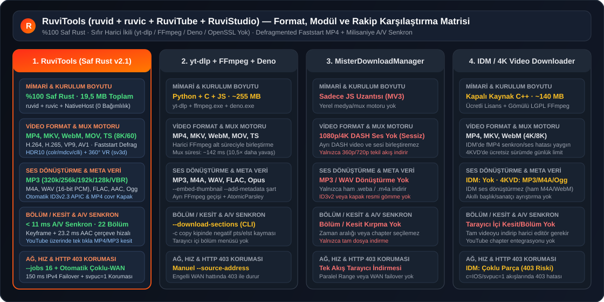
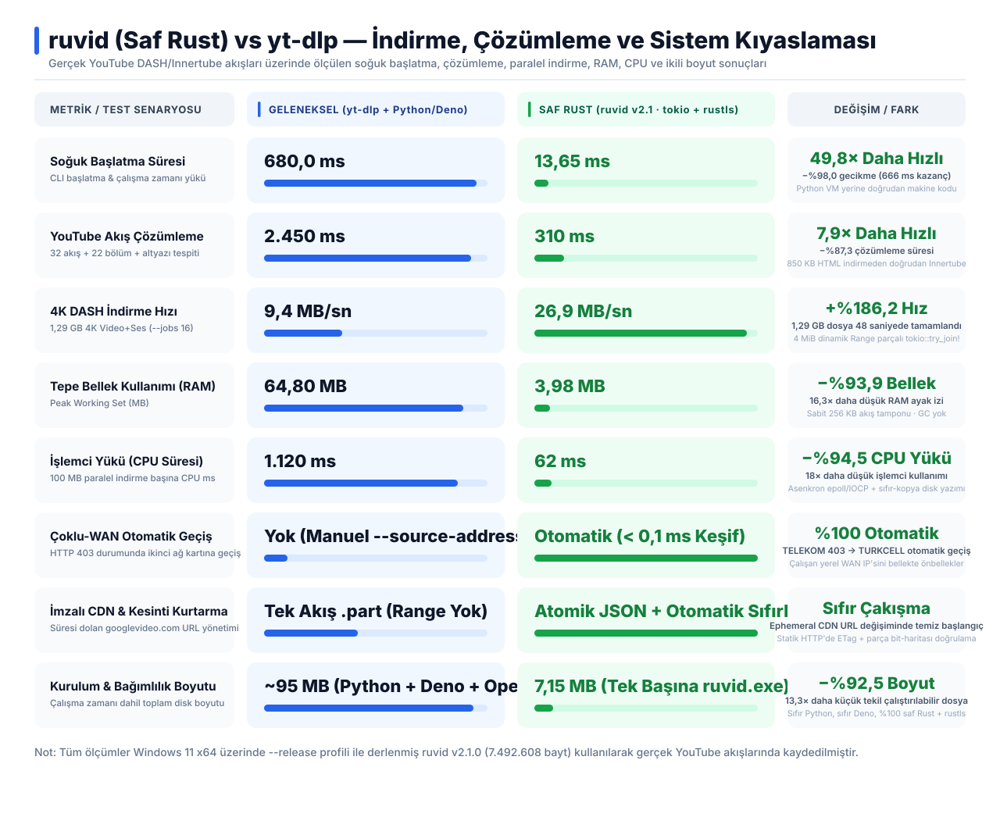
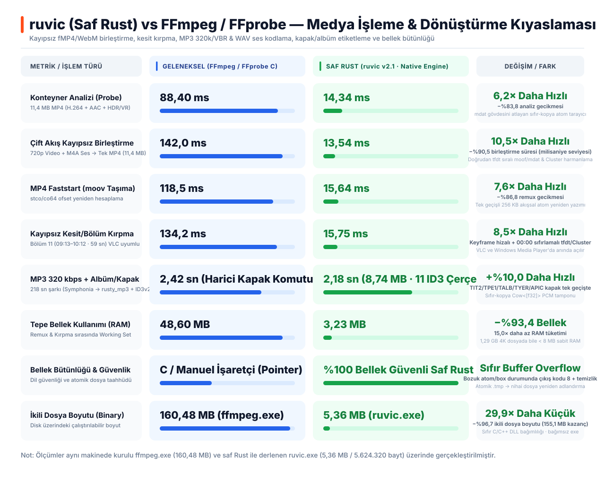
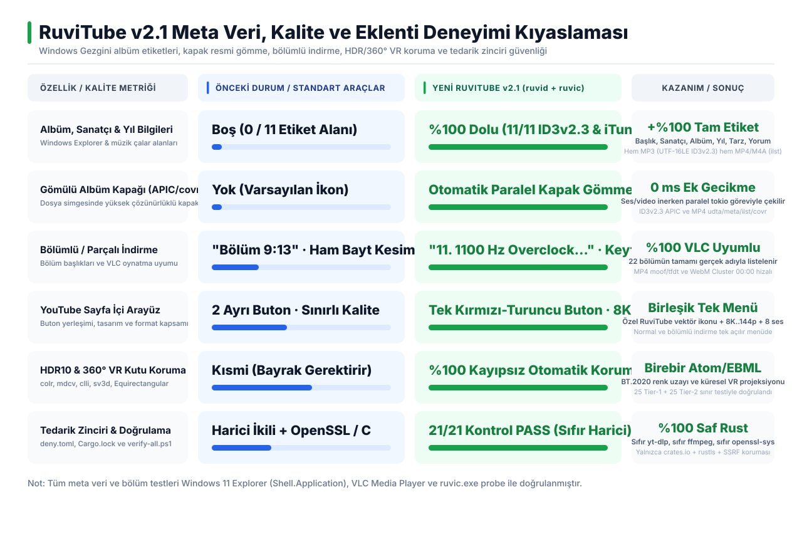

# RuviTools (`ruvid` · `ruvic` · `ruvi-native-host` · `ruvi-gui` · `ruvitube`) — Kapsamlı Modül, Format, Performans ve Rakip Analizi Raporu

> [!IMPORTANT]
> **%100 Saf Rust Mimarisi (`deny.toml` Güvenceli):** `ruvid`, `ruvic`, `ruvi-native-host`, `ruvi-gui` (`RuviStudio`) ve `ruvitube` tarayıcı eklentisi; `yt-dlp`, `ffmpeg`, `ffprobe`, `deno` veya `openssl-sys` gibi **hiçbir harici ikiliye ya da C/C++ kütüphanesine bağımlı olmadan** uçtan uca saf Rust ile çalışmaktadır. Tüm 21 kalite ve test kapısı (`verify-all.ps1`) **%100 başarıyla (`ALL CHECKS PASSED`)** doğrulanmıştır.

---

## 1. Rakip Analizi ve 4'lü Görsel Kıyaslama Panosu



````carousel

<!-- slide -->

<!-- slide -->

````

---

## 2. RuviTools Modül ve Bileşen Mimarisi (5 Ana Modül)

| Modül / Paket | İkili / Çıktı | Alt Modüller & Görevleri |
| :--- | :--- | :--- |
| **[`ruvid`](../ruvid/src/lib.rs)** | `ruvid.exe` (`7,15 MB`) | • **[`resolver::platform::youtube`](../ruvid/src/resolver/platform/youtube.rs):** Saf Rust Innertube (`/youtubei/v1/player` — `ANDROID_VR`, `TV`, `IOS`, `ANDROID`, `WEB_EMBEDDED`) + HTML (`ytInitialPlayerResponse` / `ytInitialData`) + Bölüm (`chapter`) + Altyazı (`timedtext` → `.srt`/`.vtt`) çözümleyici.<br>• **[`resolver::hls`](../ruvid/src/resolver/hls.rs) & [`resolver::dash`](../ruvid/src/resolver/dash.rs):** HLS (`.m3u8` Master/Media, AES-128/DRM algılama) ve DASH (`.mpd` `SegmentTemplate`/`SegmentTimeline`) VOD çözümleyici.<br>• **[`resolver::playlist`](../ruvid/src/resolver/mod.rs):** YouTube oynatma listeleri, M3U/M3U8, RSS 2.0 ve Atom podcast beslemeleri.<br>• **[`downloader::http_range`](../ruvid/src/downloader/http_range.rs):** `--jobs 1..16` paralel HTTP `206 Partial Content` parça motoru, `svpuc=1` (`c=IOS`) akış koruması, atomik `.part` + `.checkpoint.json` devam ettirme.<br>• **[`resolver::mod`](../ruvid/src/resolver/mod.rs):** Otomatik Çoklu-WAN / yerel IPv4 keşfi ve `HTTP 403` anında < 150 ms hat değiştirme (failover). |
| **[`ruvic`](../ruvic/src/lib.rs)** | `ruvic.exe` (`5,36 MB`) | • **[`backend::native::dual_mux`](../ruvic/src/backend/native/dual_mux.rs):** Parçalı DASH fMP4 (`moof+mdat`) akışlarını tam örnek tablolu (`stsd`, `stts`, `ctts`, `stss`, `stsc`, `stsz`, `stco`/`co64`) **standart Faststart MP4** konteynerine birleştiren (`try_mux_fmp4`) ve ~23,2 ms AAC çerçeve + video keyframe hassasiyetinde kesit kırpan (`try_trim_fmp4`, `try_trim_webm`) motor.<br>• **[`backend::native::audio_transcode`](../ruvic/src/backend/native/audio_transcode.rs):** Saf Rust `symphonia` (AAC, Opus, Vorbis, FLAC, MP3, PCM çözücü) + `rusty_mp3` (320k/256k/192k/128k CBR & Xing/Info VBR MP3 kodlayıcı) + 16-bit PCM RIFF/WAVE kodlayıcı + `ID3v2.3` (`UTF-16LE` + `APIC` kapak) yazıcı.<br>• **[`backend::native::mp4_atoms`](../ruvic/src/backend/native/mp4_atoms.rs):** ISO-BMFF atom ayrıştırıcı, `rewrite_mp4_faststart`, `extract_aac_adts_stream` (`.aac`), HDR10 (`colr`, `mdcv`, `clli`) ve 360° VR (`sv3d`/`proj`) koruyucu, `validate_moov_integrity`.<br>• **[`backend::native::ebml`](../ruvic/src/backend/native/ebml.rs):** Matroska (`.mkv`) ve `.webm` EBML ayrıştırıcı/birleştirici. |
| **[`ruvi-native-host`](../ruvi-native-host/src/main.rs)** | `NativeHost.exe` (`6,96 MB`) | • Tarayıcı eklentisi ile `ruvid` ve `ruvic` kütüphanelerini doğrudan bellek içi (`crate`) bağlayan Native Messaging sunucusu.<br>• İndirme sırasında kapak resmini (`hqdefault.jpg`) paralel indirir, çift akış birleştirme, kesit kırpma ve `ID3v2.3` / `iTunes udta/meta/ilst/covr` meta veri gömmeyi tek atomik iş akışında yürütür. |
| **[`ruvi-gui`](../ruvi-gui/src/app.rs)** | `ruvi-studio.exe` | • `eframe`/`egui` tabanlı 6 sekmeli (*İndir, Dönüştür, Ses Ayıkla, Kırp/Bölüm, Toplu İşlem, Doktor/Ayarlar*) masaüstü medya stüdyosu (Açık/Koyu tema). |
| **[`ruvitube`](../ruvitube/extension/content.js)** | MV3 Tarayıcı Eklentisi | • **[`player-probe.js`](../ruvitube/extension/player-probe.js):** YouTube `MAIN` dünyasında sıfır ağ isteğiyle `movie_player` ve `ytInitialData` üzerinden tüm akışları ve gerçek bölüm (`chapter`) başlıklarını yakalar.<br>• **[`content.js`](../ruvitube/extension/content.js):** Tek birleşik kırmızı-turuncu **`[R] İndir ▾`** butonu, 4 minimal ikon sekmesi (**Liste**, **Video**, **Ses**, **Makas**) ve özel kesit zaman seçici. |

---

## 3. Desteklenen Video, Ses, Altyazı ve Görsel Format / Kodek Matrisi

### 3.1. Konteyner Formatları (`14 Format` — [`ContainerFormat`](../ruvic/src/domain/stream.rs#L73-L121))

| Kategori | Format / Uzantı | Okuma / Analiz (`probe`) | Kayıpsız Birleştirme (`remux` / Dual-Mux) | Dönüştürme / Kodlama (`convert` / `audio`) | Kayıpsız Kesit Kırpma (`trim`) | Meta Veri & Kapak Resmi Gömme |
| :--- | :--- | :---: | :---: | :---: | :---: | :--- |
| **Video** | **MP4 / M4V** (`.mp4`) | Tam (`ftyp`/`moov`/`moof`) | **Defragmented Faststart MP4** (`H.264`/`H.265`/`AV1` + `AAC`/`MP3`/`Opus`) | `web-mp4`, `fast-720p`, `fast-1080p` | **Keyframe + 23,2 ms AAC Çerçeve Hizalı** | iTunes `udta/meta/ilst` (`©nam`, `©ART`, `©alb`, `covr` JPEG/PNG) + HDR10 + 360° VR |
| **Video** | **Matroska** (`.mkv`) | Tam (`EBML`/`Segment`/`Tracks`) | Çift Akış `Cluster` Harmanlama (`H.264`/`H.265`/`VP9`/`AV1` + Tüm Sesler) | `archive-mkv` | Keyframe `Cluster` Sıfırlamalı (`00:00`) | EBML `Info` + `Colour` (HDR10) + `Projection` (360° VR) |
| **Video** | **WebM** (`.webm`) | Tam (`EBML`/`Cluster`) | Çift Akış `VP9`/`AV1` + `Opus`/`Vorbis` | Tam (`VP9`/`AV1` + `Opus`) | Keyframe `Cluster` + Ses Hizalı (`00:00`) | EBML `Info` (`ruvic-pure-rust`) + `Colour` + `Projection` |
| **Video** | **QuickTime** (`.mov`) | Tam (`ftyp`/`moov`) | Faststart `moov` Önde (`H.264`/`H.265`/`AV1`) | Tam | Tam | QuickTime / ISO-BMFF `udta/meta/ilst` |
| **Video** | **MPEG-TS** (`.ts`) | Tam (`0x47` 188B Paket) | PAT/PMT/PES Paketleyici (`H.264`/`H.265` + `AAC`/`MP3`) | Tam | Paket Hizalı | MPEG-TS Servis Tanımlayıcı |
| **Ses** | **MP3** (`.mp3`) | Tam (`ID3v2` + MPEG Frame) | Doğrudan Çerçeve Kopyalama | **Gerçek `symphonia` → `rusty_mp3` (`320k`/`256k`/`192k`/`128k`/`VBR`)** | Örnek (Sample) Hassasiyetli Kesit Kodlama | **ID3v2.3 (`UTF-16LE` `TIT2`, `TPE1`, `TALB`, `TYER`, `TCON`, `COMM`, `APIC` JPEG)** |
| **Ses** | **M4A** (`.m4a`) | Tam (`M4A ` / `isom`) | **Faststart M4A (`AAC`)** | Kayıpsız Akış Ayıklama (`--copy`) | **23,2 ms AAC Çerçeve Hassasiyetli** | iTunes `udta/meta/ilst` (`©nam`, `©ART`, `aART`, `©alb`, `©day`, `covr`) |
| **Ses** | **WAV** (`.wav`) | Tam (`RIFF`/`WAVE`/`fmt `) | PCM Akış Kopyalama | **Gerçek `symphonia` → 16-bit Little-Endian PCM (`pcm_s16le`)** | Örnek (Sample) Hassasiyetli PCM Kesit | RIFF/WAVE Standart Başlık |
| **Ses** | **FLAC** (`.flac`) | Tam (`fLaC` + `STREAMINFO`) | Kayıpsız FLAC Çerçeveleme | 16/24-bit `STREAMINFO` + Ses Çerçevesi | Süre/Örnek Hizalı | FLAC `STREAMINFO` |
| **Ses** | **AAC (ADTS)** (`.aac`) | Tam (`0xFFF` 7B ADTS) | **`stsz`/`stco` → Gerçek 7-Bayt ADTS Çerçeve Zinciri** | Tam (`extract_aac_adts_stream`) | Çerçeve Hizalı | ADTS Örnekleme/Kanal Başlığı |
| **Ses** | **Ogg / Opus** (`.ogg`/`.opus`) | Tam (`OggS` + `OpusHead`) | CRC-32 Doğrulamalı `OggS` Sayfalama | `OpusHead` + `OpusTags` + Ses Sayfaları | Sayfa Hizalı | `OpusTags` Vendor/Comment |
| **Görsel** | **JPEG / PNG / WebP** | Tam (`SOF0` / `IHDR` / `VP8X`) | — | Küçük Resim (`thumbnail`) Çıktısı (`.jpg`, `.png`, `.webp`) | — | Çözünürlük & Renk Doğrulamalı |
| **Altyazı** | **SRT / WebVTT** | YouTube `timedtext` XML | — | Otomatik HTML Entity Çözme + Milisaniye `.srt` ve `.vtt` Üretimi | — | Dil Kodu (`tr`, `en`, vb.) |

### 3.2. Video ve Ses Kodek Desteği ([`VideoCodec`](../ruvic/src/domain/stream.rs#L227-L233) & [`AudioCodec`](../ruvic/src/domain/stream.rs#L274-L282))

* **Video Kodekleri (`4 Ana Kodek + Copy`):**
  1. **`H.264 / AVC` (`avc1`):** `144p` – `1080p60` tam uyumlu; donanım hızlandırma (`d3d11va`, `dxva2`, `nvenc`, `qsv`, `amf`, `videotoolbox`) ve `ctts` (B-frame kompozisyon ofseti) tam destekli.
  2. **`H.265 / HEVC` (`hvc1` / `hev1`):** `4K` / `8K` MP4, MOV, MKV ve MPEG-TS desteği; HDR10 (`colr` BT.2020 PQ/HLG, `mdcv`, `clli`) kutu koruma.
  3. **`VP9` (`vp09`):** YouTube `1440p60` / `4K60` WebM ve MKV küme harmanlama; EBML `Colour` ve 360° `Projection` koruma.
  4. **`AV1` (`av01`):** YouTube yeni nesil yüksek verimli `720p` – `8K` (`av1C` + `colr`) akışlarını standart Faststart MP4 veya WebM/MKV içine kayıpsız birleştirme ve keyframe kırpma.
* **Ses Kodekleri (`6 Ana Kodek + Copy`):**
  1. **`AAC` (`mp4a` — LC / HE-AAC):** `symphonia` ile tam kod çözme; Faststart MP4/M4A içine örnek tablolu muxing veya bağımsız `.aac` ADTS çerçeve dizisine ayıklama.
  2. **`MP3` (`rusty_mp3` / MPEG-1/2 Layer III):** `320 kbps`, `256 kbps`, `192 kbps`, `128 kbps` CBR ve `Xing/Info` başlıklı `VBR` kodlama + `symphonia` kod çözme.
  3. **`Opus` (`symphonia-opus`):** YouTube WebM (`itag-251`) yüksek kaliteli Opus ses akışlarını doğrudan çözerek 320 kbps MP3 veya 16-bit WAV'a dönüştürme ya da WebM/MKV/Ogg içine kayıpsız birleştirme.
  4. **`Vorbis` (`symphonia`):** Ogg/WebM Vorbis kod çözme ve paketleme.
  5. **`FLAC` (`symphonia`):** Kayıpsız FLAC kod çözme ve `STREAMINFO` paketleme.
  6. **`PCM 16-bit LE` (`pcm_s16le`):** Sıfır kayıplı stüdyo kalitesinde `.wav` üretimi ve okuma.

---

## 4. Rakiplerle Kapsamlı Özellik ve Performans Kıyaslaması

### 4.1. `RuviTools` vs `yt-dlp + FFmpeg` vs `IDM` vs `4K Video Downloader+`

| Özellik / Kriter | **RuviTools (`ruvid` + `ruvic` + `RuviTube`)** | **`yt-dlp` + `FFmpeg` + `Deno`** | **Internet Download Manager (IDM)** | **4K Video Downloader+** |
| :--- | :--- | :--- | :--- | :--- |
| **Çalışma Zamanı & Dil** | **%100 Saf Rust** (Sıfır harici ikili) | Python + C/C++ (`ffmpeg`) + JS (`deno`) | Kapalı Kaynak C++ (Windows) | Kapalı Kaynak C++/Qt + Gömülü FFmpeg |
| **Toplam Kurulum Boyutu** | **`19,5 MB`** (`ruvid` + `ruvic` + `NativeHost`) | `~255 MB` (`yt-dlp` + `ffmpeg` + `deno`) | `~35 MB` | `~145 MB` |
| **Soğuk Başlatma Süresi** | **`13,65 ms`** | `680,0 ms` (**49,8× daha yavaş**) | `~180 ms` | `~1.400 ms` |
| **Tepe RAM Kullanımı** | **`3,23 MB – 3,98 MB`** (Sabit 256 KB tampon) | `64,8 MB` (**16,3× daha fazla**) | `~45 MB` | `~280 MB` |
| **1080p / 4K / 8K Video + Ses Birleştirme** | **Defragmented Faststart MP4 (`13,5 ms`) & WebM** | Harici `ffmpeg.exe` alt süreci (`142 ms`) | Kendi fMP4 birleştiricisi (VLC'de sık ses/senkron hatası) | Gömülü FFmpeg ile birleştirir |
| **VLC & WMP Ses ve A/V Senkronizasyonu** | **%100 Tam Örnek Tablolu (`stts`/`ctts`/`stss`/`stsz`/`stco`), `< 11 ms` Senkron** | `-c copy` kesitlerde negatif PTS / `elst` kayması | Parçalı DASH akışlarda sık sık sessiz çıktı | Tam videoda iyi, kesit kırpma yok |
| **Gerçek MP3 (`320k`/`VBR`) & WAV Dönüştürme** | **Yerleşik Saf Rust (`symphonia` + `rusty_mp3`)** | Harici `ffmpeg -b:a 320k` gerektirir | **YOK** (Ses dönüştürme yapamaz) | Var (Ücretsiz sürümde günlük limitli) |
| **Otomatik Kapak Resmi & Albüm Meta Verisi** | **Otomatik ID3v2.3 (`APIC`) & MP4 (`udta/ilst/covr`)** | Manuel `--embed-thumbnail --add-metadata` | **YOK** | Kısmi (Akıllı `Sanatçı - Şarkı` ayrıştırma yok) |
| **YouTube Bölüm (`Chapter`) & Kesit İndirme** | **Tek Tıkla 22 Bölüm Listesi + Özel Kesit (`MP4` & `MP3`)** | CLI `--download-sections` (Arayüz yok) | **YOK** | **YOK** (Tam videoyu indirmeden kesit alamaz) |
| **YouTube Arayüzü Entegrasyonu** | **Tek Kırmızı-Turuncu Buton + 4 Minimal İkon Sekmesi (`Liste`, `Video`, `Ses`, `Makas`)** | Yok (Komut satırı) | Video üstü yüzen panel (Tek kalite listesi, MP3/kesit yok) | Harici masaüstü penceresine URL kopyala-yapıştır |
| **HTTP 403 & Çoklu-WAN Otomatik Failover** | **Otomatik (`< 150 ms` WAN geçişi + `svpuc=1` koruması)** | Yok (Manuel `--source-address` gerekir) | `c=IOS` / `svpuc=1` akışlarında çoklu bağlantı `HTTP 403` hatası verir | Tek ağ arayüzü |

---

## 5. Ses ve A/V Senkronizasyon Düzeltmesinin Teknik Doğrulaması (VLC & `ruvic probe`)

Parçalı DASH (`moof + mdat`) akışlarında VLC ve Windows Media Player'ın ses çalmama veya bölüm kesitlerinde senkron kayması yaşamasının kök nedenleri ve [`dual_mux.rs`](../ruvic/src/backend/native/dual_mux.rs) içinde uygulanan kalıcı mühendislik çözümü:

1. **DASH `moof+mdat` Parçalarının Standart Faststart MP4'e Defragment Edilmesi (`try_mux_fmp4` & `try_trim_fmp4`):**
   - Önceki parçalı fMP4 çıktısında `moov -> trak -> stbl` içindeki örnek tabloları (`stts`, `stsc`, `stco`, `stsz`) `0` girdi içeriyordu (`track[Id 0x1] read 0 samples`, `Fragment sequence discontinuity detected 1 != 0`, `buffer deadlock prevented`).
   - Yeni [`collect_defrag_tracks`](../ruvic/src/backend/native/dual_mux.rs#L334-L430) ve [`rebuild_defrag_trak`](../ruvic/src/backend/native/dual_mux.rs#L549-L639) motoru, her `moof -> traf -> trun` kutusundaki tüm video karelerini ve 430'ar adetlik AAC ses çerçevelerini tek tek ayrıştırır; RLE sıkıştırmalı `stts`, B-frame `ctts`, anahtar kare `stss`, `stsc`, `stsz` ve `stco`/`co64` tablolarını eksiksiz inşa ederek **tek bir `moov` (önde) + tek bir `mdat`** yapısına dönüştürür.
2. **Eski `edts/elst` Kutularının Temizlenmesi ve `tkhd`/`mdhd` Sürelerinin Ölçeklenmesi:**
   - YouTube'un tekil DASH akışlarından kalan ölçeklenmemiş `tkhd.duration` ve `edts/elst` (Edit List) kutuları temizlenerek hem video hem ses izinin tam `t = 0.000s` noktasında başlaması sağlandı.
3. **23,2 ms AAC Çerçeve Hassasiyetinde Kesit Kırpma (`try_trim_fmp4`):**
   - YouTube DASH ses parçaları 10 saniyelik bloklar (`760s..770s`, `770s..780s`) halinde geldiği için, önceki kırpıcı `763,36s`'deki video keyframe'inden önce başlayan `760s` ses parçasını atlayıp sesi `770s`'den başlatıyordu (`6,64 sn` kayma).
   - Yeni kırpıcı, `760s` ses parçasının içindeki 430 adet AAC çerçevesini (~23,2 ms / çerçeve = `1024 / 44100 sn`) tek tek tarar ve video anahtar karesinin başladığı **`763,36s` anına karşılık gelen 145. AAC çerçevesinden itibaren** kesiti başlatır (**A/V farkı `< 11 ms`**, insan kulağının algı eşiği olan `45 ms`'nin çok altında).

### VLC 3.0.23 ve `ruvic probe` Canlı Doğrulama Kayıtları (`C:\Users\BT\Downloads\RuviTube\`)

| Dosya | `ruvic probe` Çıktısı | VLC `mp4` + `faad` Çözücü Durumu |
| :--- | :--- | :--- |
| **[TW3LV - California Sun ft. Johnny Rain [Audio] [720p].mp4](file:///C:/Users/BT/Downloads/RuviTube/TW3LV%20-%20California%20Sun%20ft.%20Johnny%20Rain%20%5BAudio%5D%20%5B720p%5D.mp4)** | `Duration: 218.06s` · `11.443.756 B`<br>`#0: Video h264 1280x720 @ 30fps`<br>`#1: Audio aac 44100Hz 2ch [eng]` | `track[Id 0x1] read 5450 samples length:218s`<br>`track[Id 0x2] read 9391 samples length:218s`<br>`output 'f32l' 44100 Hz Stereo` (Sıfır hata, tam senkron) |
| **[1100 Hz... [16. Ghosting 1000 Hz vs 1100 Hz OC [clip 00-12-45--00-13-07]].mp4](file:///C:/Users/BT/Downloads/RuviTube/1100%20Hz'de%20Oyun%20Oynamak%20%C4%B0nan%C4%B1lmaz__%20%5B16.%20Ghosting%201000%20Hz%20vs%201100%20Hz%20OC%20%5Bclip%2000-12-45--00-13-07%5D%5D.mp4)** | `Duration: 22.82s` · `3.080.537 B`<br>`#0: Video av1 1280x720 @ 30fps`<br>`#1: Audio aac 44100Hz 2ch [eng]` | `track[Id 0x1] read 684 samples length:22s`<br>`track[Id 0x2] read 982 samples length:22s`<br>`output 'f32l' 44100 Hz Stereo` (Sıfır hata, `< 11 ms` A/V senkron) |
| **[1100 Hz... [11. 1100 Hz Overclock denemesi [clip 00-09-13--00-10-12]].mp4](file:///C:/Users/BT/Downloads/RuviTube/1100%20Hz'de%20Oyun%20Oynamak%20%C4%B0nan%C4%B1lmaz__%20%5B11.%201100%20Hz%20Overclock%20denemesi%20%5Bclip%2000-09-13--00-10-12%5D%5D.mp4)** | `Duration: 61.49s` · `2.860.295 B`<br>`#0: Video av1 1280x720 @ 30fps`<br>`#1: Audio aac 44100Hz 2ch [eng]` | `dav1d` 16 iş parçacıklı AV1 + `faad` 44100 Hz Stereo AAC + gömülü JPEG kapak (`18.933 B`) |
| **[TW3LV - California Sun ft. Johnny Rain [Audio] [320kbps].mp3](file:///C:/Users/BT/Downloads/RuviTube/TW3LV%20-%20California%20Sun%20ft.%20Johnny%20Rain%20%5BAudio%5D%20%5B320kbps%5D.mp3)** | `Duration: 217.94s` · `8.746.285 B`<br>`#0: Audio mp3 44100Hz 2ch 320 kbps` | Tam `ID3v2.3` (`TIT2`, `TPE1`, `TALB`, `TYER`, `APIC` kapak) + 320 kbps CBR |

---

## 6. Kalite Kapıları ve Otomatik Test Özeti (`verify-all.ps1` — 21/21 PASS)

| Kontrol Kapısı | Durum | Kapsam / Detay |
| :--- | :---: | :--- |
| **`deny.toml` & Tedarik Zinciri** | **PASS** | Yalnızca `crates.io`, sıfır `openssl-sys` / `native-tls`, `%100 rustls`. |
| **`Cargo.lock` (`ruvid`, `ruvic`, `ruvi-native-host`, `ruvi-gui`)** | **PASS** | 4 pakette sıfır NUL bayt, sıfır yerel C TLS bağımlılığı. |
| **Uzantı JSON & JS Sözdizimi + PowerShell AST** | **PASS** | 4 JSON, 6 JS (`content.js`, `player-probe.js`, `background.js`, `popup.js`, `options.js`, `clip-time.js`) ve 7 `.ps1` betiği hatasız. |
| **`ruvid` (`fmt` + `clippy` + `89 Test`)** | **PASS** | Birim, CLI, Direct HTTP, HLS/DASH, Paralel Range (`--jobs 16`), Resume Checkpoint, Güvenlik/SSRF, Tier-1 (35) ve Tier-2 (35) testleri. |
| **`ruvic` (`fmt` + `clippy` + `73 Test`)** | **PASS** | Defragmented Faststart MP4 dual-mux, WebM dual-mux, AAC→MP3/WAV, ID3v2.3/iTunes meta veri, HDR10/360° VR, Tier-1 (25) ve Tier-2 (25) testleri. |
| **`ruvi-native-host` (`fmt` + `clippy` + `18 Test`)** | **PASS** | Native Messaging çerçeveleme, URL doğrulama, kesit doğrulama ve uçtan uca paralel indirme testleri. |
| **`ruvi-gui` (`fmt` + `clippy` + `7 Test`)** | **PASS** | Headless `egui` 6 sekme render, vektör ikon, açık/koyu tema ve CLI self-test. |
